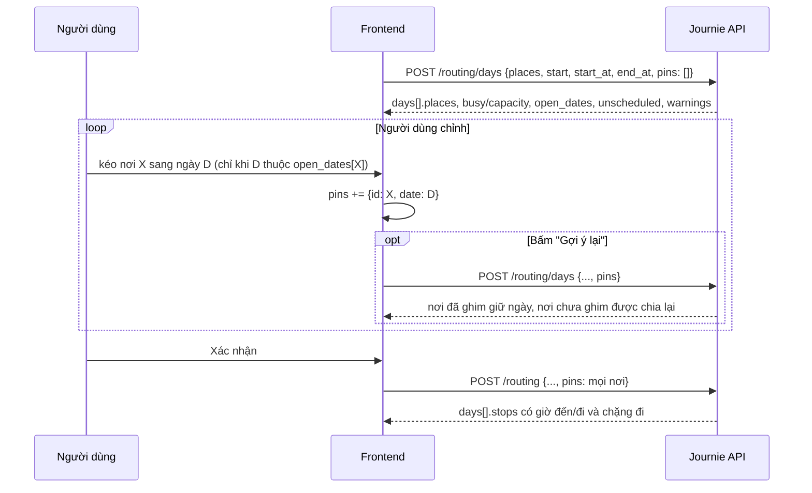

# Routing: hướng dẫn tích hợp cho frontend

Dành cho người làm frontend/mobile gọi `POST /routing/days` và `POST /routing`. Chi tiết
schema luôn có ở `/docs` (Swagger) khi server chạy; tổng quan các endpoint ở [API.md](API.md).

- [Tóm tắt](#tóm-tắt)
- [Bước 1: gọi POST /routing/days](#bước-1-gọi-post-routingdays)
- [Hiển thị kết quả chia ngày](#hiển-thị-kết-quả-chia-ngày)
- [Kéo thả, ghim và gợi ý lại](#kéo-thả-ghim-và-gợi-ý-lại)
- [Bước 2: gọi POST /routing để lấy lịch có giờ](#bước-2-gọi-post-routing-để-lấy-lịch-có-giờ)
- [Xử lý unscheduled và warnings](#xử-lý-unscheduled-và-warnings)
- [Lỗi, thời gian chờ và retry](#lỗi-thời-gian-chờ-và-retry)
- [Giới hạn, múi giờ và trường hợp cần test](#giới-hạn-múi-giờ-và-trường-hợp-cần-test)

---

## Tóm tắt

Frontend gọi hai endpoint theo thứ tự: `POST /routing/days` để lấy gợi ý mỗi ngày đi đâu, cho
người dùng chỉnh, rồi `POST /routing` để lấy lịch có giờ. Hai endpoint nhận **cùng một
request**; chỉ khác ở dạng response.

1. **Gợi ý chia ngày.** Gửi các nơi người dùng đã chọn tới `/routing/days`. Server trả mỗi ngày
   một danh sách nơi, tải của ngày và các ngày mỗi nơi mở cửa.
2. **Người dùng chỉnh.** Kéo thả giữa các ngày ngay trên frontend. Nơi nào người dùng đã đặt
   thì ghi vào `pins`. Muốn máy chia lại phần còn lại: gọi lại `/routing/days` kèm `pins`.
3. **Xếp lịch có giờ.** Khi người dùng bấm xác nhận, gửi `/routing` với **mọi** nơi nằm trong
   `pins`. Server giữ đúng cách chia của người dùng, chỉ sắp thứ tự và tính giờ trong từng ngày.



Nút "Tự xếp hết" (bỏ qua bước duyệt) là gọi thẳng `/routing` không có `pins`: server tự chia
ngày và xếp giờ trong một lần.

---

## Bước 1: gọi `POST /routing/days`

Request dựng từ các card người dùng đã chọn ở `/retrieval`, vị trí của người dùng và thời gian
của trip.

```json
{
  "places": [<PoiCard>, <PoiCard>, ...],
  "must_visit_ids": ["dinh-doc-lap-97d379"],
  "start": {"lat": 10.7725, "lon": 106.698},
  "start_at": "2026-11-21T08:00",
  "end_at": "2026-11-22T21:00",
  "day_start": "08:00",
  "day_end": "21:00",
  "pins": []
}
```

| Field | Bắt buộc | Lấy từ đâu | Ràng buộc |
|---|---|---|---|
| `places` | Có | Card nguyên vẹn từ `/retrieval` (`pinned` và `sections[].items`) mà người dùng đã chọn | 1–50 card, `id` không trùng. Server chỉ đọc `id` và trả lại card nguyên như gửi lên |
| `must_visit_ids` | Không | `id` của các card trong `pinned` của `/retrieval` (nơi người dùng nói "nhất định phải đi") | Mỗi id phải có trong `places`. Được giữ trước khi không xếp đủ |
| `start` | Có | Vị trí hiện tại (GPS); người dùng được sửa, ví dụ chọn khách sạn | Mỗi ngày xuất phát và quay về điểm này |
| `start_at`, `end_at` | Có | Ngày giờ bắt đầu và kết thúc cả trip | `end_at` sau `start_at`, trip tối đa 14 ngày. Không có múi giờ thì server hiểu là giờ Việt Nam |
| `day_start`, `day_end` | Không (mặc định `08:00`, `21:00`) | Cài đặt của người dùng | `HH:MM`, `day_end` sau `day_start` |
| `pins` | Không | Nơi người dùng đã đặt vào một ngày (lần gọi đầu: để trống) | `[{"id", "date"}]`, id có trong `places` và không trùng, `date` nằm trong trip |

Cách server hiểu giờ của từng ngày:

- Ngày đầu: từ giờ của `start_at` tới `day_end`.
- Các ngày giữa: từ `day_start` tới `day_end`.
- Ngày cuối: từ `day_start` tới mốc sớm hơn giữa `day_end` và giờ của `end_at`.

Ví dụ đến Sài Gòn lúc 14:30 và bay về lúc 12:00 hôm sau: `start_at` = `...T14:30`, `end_at` =
`...T12:00`. Ngày đầu còn 14:30–21:00, ngày cuối 08:00–12:00.

> **Đừng nhầm hai chữ "pinned".** `pinned` trong response của `/retrieval` là các nơi bắt buộc
> đi → đưa vào `must_visit_ids`. `pins` của routing là nơi đã gắn vào **một ngày cụ thể**.

---

## Hiển thị kết quả chia ngày

Response của `/routing/days` có đủ mọi ngày của trip, kể cả ngày không có nơi nào.

```json
{
  "days": [
    {"date": "2026-11-21", "places": [<PoiCard>, ...],
     "busy_minutes": 391, "capacity_minutes": 780},
    {"date": "2026-11-22", "places": [<PoiCard>, ...],
     "busy_minutes": 292, "capacity_minutes": 780}
  ],
  "unscheduled": [{"poi": <PoiCard>, "reason": "closed_on_trip_days"}],
  "open_dates": {"dinh-doc-lap-97d379": ["2026-11-21", "2026-11-22"]},
  "warnings": ["day_max:food.cafe:2026-11-21"],
  "meta": {"routing_version": "routing-v2", "rules_version": "rules-v1", ...}
}
```

| Field | Hiển thị thế nào |
|---|---|
| `days[].places` | Một cột hoặc một thẻ cho mỗi ngày. Thứ tự trong mảng là thứ tự đi dự kiến; có thể hiển thị nguyên thứ tự này |
| `busy_minutes` / `capacity_minutes` | Thanh tải của ngày, ví dụ "Bận 6h31 / 13h". `busy` = thời gian tham quan + di chuyển. `capacity_minutes` có thể bằng 0 (ví dụ `start_at` sau `day_end`): khi đó không chia cho nó, hiển thị "Không còn thời gian" |
| `open_dates` | Không hiển thị trực tiếp. Dùng để chặn kéo thả (phần sau) |
| `unscheduled` | Một mục riêng "Chưa xếp được", kèm lý do (bảng mã ở phần sau) |
| `warnings` | Ghi chú nhỏ gắn vào đúng ngày nếu mã có ngày (bảng mã ở phần sau) |

Về cân bằng: server chấp nhận các ngày lệch nhau tới 15 điểm % tỉ lệ bận (ví dụ 50% và 37%).
Trong ngưỡng đó nó ưu tiên mỗi ngày gọn theo khu. Hai ngày lệch nhẹ là bình thường, không phải
lỗi.

`open_dates` chỉ có key cho nơi tìm thấy trong DB và có toạ độ. Nơi có key nhưng mảng rỗng là
nơi đóng cửa mọi ngày của trip.

---

## Kéo thả, ghim và gợi ý lại

Frontend giữ hai thứ trong state: ngày hiện tại của mỗi nơi (`placeId → date`, khởi tạo từ
`days[].places`), và tập các nơi người dùng đã tự đặt. Mỗi nơi trong tập đó trở thành một phần
tử của `pins`.

| Người dùng làm | Frontend xử lý | Có gọi API không |
|---|---|---|
| Kéo nơi X sang ngày D | Chỉ cho thả nếu D có trong `open_dates[X]`; ngày không hợp lệ thì làm mờ khi đang kéo. Thả xong: ghi `{"id": X, "date": D}` vào `pins` | Không bắt buộc (xem dòng cuối) |
| Ghim một nơi vào ngày đang đứng (không kéo) | Thêm `{"id", "date"}` vào `pins` | Không |
| Bỏ ghim | Xóa nơi đó khỏi `pins` | Không |
| Bấm "Gợi ý lại" | Gửi `/routing/days` với `pins` hiện tại. Nơi đã ghim giữ nguyên ngày; nơi chưa ghim được chia lại và có thể đổi ngày | Có |
| Xóa một nơi khỏi trip | Xóa khỏi `places`, **và** khỏi `pins` và `must_visit_ids`. Còn sót ở hai mảng sau thì server trả 422 | Khi bấm gợi ý lại |
| Thêm nơi mới | Thêm card vào `places`, không ghim, rồi "Gợi ý lại" để máy tìm ngày cho nó | Có |
| Đổi ngày đi/về của trip | Bỏ mọi pin có `date` nằm ngoài trip mới (còn giữ thì 422), rồi gọi lại `/routing/days` | Có |
| Muốn xem tải mới sau khi kéo tay | Gọi `/routing/days` với **mọi** nơi trong `pins`: server không chia lại, chỉ tính lại `busy_minutes` và cảnh báo cho đúng cách chia của người dùng | Có |

Lưu ý:

- Sau khi kéo tay, `busy_minutes` cũ không còn đúng. Hoặc đánh dấu là "chưa cập nhật", hoặc tự
  gọi lại như dòng cuối của bảng. Nếu tự gọi thì debounce (ví dụ 1 giây sau lần kéo cuối), đừng
  gọi mỗi lần thả.
- Cùng một request cho cùng kết quả. Bấm "Gợi ý lại" mà không đổi gì sẽ ra y hệt; có thể tắt
  nút khi state chưa đổi. Ngoại lệ: request rất lớn trên server đang bận có thể chạm giới hạn
  thời gian của solver, khi đó kết quả là lời giải tốt nhất tới lúc dừng.
- Ghim có ưu tiên cao hơn cân bằng: người dùng ghim 6 nơi vào một ngày thì server giữ nguyên, dù
  ngày đó quá tải. Nơi không vừa sẽ nằm trong `unscheduled` với lý do `no_time`.

---

## Bước 2: gọi `POST /routing` để lấy lịch có giờ

Khi người dùng xác nhận cách chia, gửi lại đúng request của bước 1, nhưng `pins` chứa **mọi**
nơi với ngày người dùng đã duyệt. Server giữ đúng ngày đó cho từng nơi, chỉ sắp thứ tự trong
ngày và tính giờ. Thiếu một nơi trong `pins` thì server được phép chuyển nó sang ngày khác.
Xếp `places` theo đúng thứ tự `days[].places` của `/routing/days` (ngày 1 trước, rồi ngày 2...):
server bắt đầu từ thứ tự đó, nên không bỏ nơi nào bước 1 đã xếp được.

```json
{
  "days": [
    {"date": "2026-11-21",
     "stops": [
       {"poi": <PoiCard>,
        "arrive": "2026-11-21T08:04:00+07:00",
        "start": "2026-11-21T09:00:00+07:00",
        "leave": "2026-11-21T09:45:00+07:00",
        "wait_minutes": 56, "visit_minutes": 45,
        "leg": {"mode": "ride", "distance_km": 1.44, "minutes": 4}}
     ],
     "return_leg": {"mode": "walk", "distance_km": 0.84, "minutes": 11}}
  ],
  "unscheduled": [],
  "warnings": [],
  "meta": {...}
}
```

Hiển thị mỗi ngày như một timeline dọc từ trên xuống:

1. Chặng đi: `leg` của stop đầu tiên là từ `start` (vị trí người dùng) tới nơi đầu. `mode` là
   `walk` (dưới 1 km) hoặc `ride`.
2. Nơi tham quan: giờ `start` – `leave`, kèm `visit_minutes`. Đây cũng là `visit_minutes` trên
   `PoiCard` của retrieval, nên khi tự chọn điểm cho từng ngày, frontend dùng đúng số này.
3. `wait_minutes` là khoảng giữa `arrive` và `start`. Đó là thời gian chờ mở cửa chỉ khi nơi
   này còn đóng cửa lúc `arrive` (theo giờ mở cửa của nơi đó), ví dụ nơi mở cửa lúc 09:00 mà
   người dùng đến lúc 08:04: hiển thị "Đến lúc `arrive`, chờ mở cửa `wait_minutes` phút". Nếu
   nơi đã mở cửa lúc `arrive` thì đó là thời gian tự do server cố ý để lại: nghỉ sau bữa trưa
   (tối đa 180 phút trước buổi tối; ngày không có bữa tối hay quán bar thì 90 / 60 / 45 phút
   theo số điểm trong ngày), hoặc thời gian trước bữa tối hay quán bar. Gợi ý: "Nghỉ trưa X"
   sau một bữa trong giờ trưa, "Thời gian tự do X trước buổi tối" trước bữa tối hoặc quán bar,
   còn lại "Trống X". Đừng ghi khoảng này là chờ mở cửa.
4. Lặp lại với stop kế tiếp: `leg` của nó là chặng từ nơi trước.
5. Cuối ngày: `return_leg` là chặng về lại `start`. Ngày không có stop nào thì `stops` rỗng và
   `return_leg` là `null`: hiển thị "Ngày tự do".

Các con số nên ghi là ước tính: thời gian tham quan là giá trị trung bình theo loại địa điểm, và
thời gian di chuyển tính theo tốc độ trung bình (đi bộ 4.5 km/h, đi xe 20 km/h), chưa tính kẹt
xe. `distance_km` có thể là 0 khi hai nơi nằm sát nhau (ví dụ Cà Phê 30-4 và Dinh Độc Lập).

Nút "Tự xếp hết": gọi thẳng `/routing` với `pins` rỗng. Response cùng dạng như trên; server tự
chia ngày với cùng luật cân bằng như `/routing/days`.

---

## Xử lý `unscheduled` và `warnings`

Cả hai endpoint dùng chung các mã dưới đây. Không mã nào làm request thất bại: server vẫn trả
lịch tốt nhất có thể và giải thích phần còn thiếu.

### `unscheduled[].reason`: nơi không có trong lịch

| `reason` | Ý nghĩa | Gợi ý hiển thị | Người dùng làm gì |
|---|---|---|---|
| `no_time` | Không xếp vừa cùng các nơi khác trong thời gian của trip (hoặc của ngày được ghim) | "Không đủ thời gian" | Chuyển sang ngày khác trong `open_dates`, bỏ bớt nơi khác, hoặc nới giờ trong ngày |
| `closed_on_trip_days` | Không mở cửa đủ lâu cho một lượt tham quan vào bất kỳ ngày nào của trip | "Đóng cửa trong thời gian chuyến đi" | Bỏ nơi này, hoặc đổi ngày đi |
| `closed_on_pinned_day` | Đóng cửa đúng ngày được ghim | "Đóng cửa ngày [date]" | Chuyển sang một ngày trong `open_dates`. Nếu frontend đã chặn kéo thả theo `open_dates` thì mã này hiếm gặp |
| `not_found` | `id` không còn trong dữ liệu (dữ liệu vừa cập nhật) | "Địa điểm không còn trong hệ thống" | Bỏ nơi này, chọn lại từ `/retrieval` |
| `no_location` | Không có toạ độ | "Chưa có vị trí trên bản đồ" | Bỏ nơi này |

Nơi có trong `must_visit_ids` mà vẫn nằm trong `unscheduled` thì nên báo nổi bật hơn, vì người
dùng đã nói phải đi.

### `warnings`: chuỗi có dạng `mã:tham số`

| Mã | Ví dụ | Ý nghĩa | Gợi ý hiển thị |
|---|---|---|---|
| `travel_estimated` | `travel_estimated` | Một phần thời gian di chuyển là ước lượng (không lấy được đường đi thật) | Một dòng chung: "Thời gian di chuyển là ước tính" |
| `hours_unknown` | `hours_unknown:ho-con-rua-7621cd` | Nơi này không có giờ mở cửa, được coi là mở cả ngày | Biểu tượng nhỏ trên thẻ: "Chưa rõ giờ mở cửa, nên kiểm tra trước" |
| `day_max` | `day_max:food.cafe:2026-11-21`, `day_max:attraction.museum:2026-11-21` | Ngày đó có nhiều hơn số cho phép (2 quán cà phê, 1 nơi `entertainment.nightlife`, 2 bảo tàng, 1 nơi `culture_religion` (chùa, đền, nhà thờ), 2 chợ `shopping.market`, 2 công viên `nature.park`) vì các nơi đã chọn không cho chia khác. Backend chỉ đếm `attraction.museum`, không tính phòng trưng bày (`attraction.gallery`); thiết bị thì đếm chung cả hai | Trên ngày đó: "Nhiều quán cà phê trong một ngày" / "Nhiều quán bar trong một tối" / "Nhiều bảo tàng trong một ngày" / "Nhiều chùa, đền, nhà thờ trong ngày này" |
| `not_before` | `not_before:entertainment.nightlife:2026-11-21` | Một quán bar phải xếp trước 18:00 vì không còn cách nào giữ đủ các nơi đã chọn | Trên ngày đó: "Quán bar được xếp trước buổi tối" |
| `day_spread` | `day_spread:food.restaurant`, `day_spread:attraction.museum` | Số nhà hàng (hoặc bảo tàng `attraction.museum`, không tính phòng trưng bày) giữa các ngày chênh nhau hơn 1 | Một dòng chung: "Nhà hàng chưa chia đều giữa các ngày". Mã của bảo tàng có thể không hiển thị: thường do bảo tàng đóng cửa một ngày của trip, người dùng khó làm gì |
| `not_adjacent` | `not_adjacent:food:2026-11-21`, `not_adjacent:attraction.museum:2026-11-21`, `not_adjacent:attraction.gallery:2026-11-21` | Ngày đó có hai nơi ăn uống (hoặc hai bảo tàng, hai phòng trưng bày) liền nhau mà không tránh được. Mỗi nhóm chỉ so với chính nó: một bảo tàng cạnh một phòng trưng bày thì backend không báo | Trên ngày đó: "Có hai điểm ăn uống liền nhau" / "Có hai bảo tàng liền nhau" |

Cách đọc:

- Tách bằng `split(":")`: phần đầu là mã, các phần sau là tham số theo bảng. Nhóm (`food.cafe`,
  `food`) và ngày (`YYYY-MM-DD`) không chứa dấu `:`.
- Nhóm là mã taxonomy, không phải chữ để hiển thị. Frontend tự dịch: `food.cafe` → "quán cà
  phê", `food.restaurant` → "nhà hàng", `food` → "ăn uống", `attraction.museum` → "bảo tàng",
  `attraction.gallery` → "phòng trưng bày".
- Gặp mã lạ thì bỏ qua, không báo lỗi: sau này có thể thêm luật mới.
- Độ cân bằng giữa các ngày không có cảnh báo riêng; xem `busy_minutes` ở `/routing/days`.

---

## Lỗi, thời gian chờ và retry

Thường mỗi lần gọi mất dưới 1–2 giây. Trường hợp xấu nhất khoảng 10 giây: bộ giải chạy tối đa 6
giây, tra đường đi tối đa 3 giây, cộng thời gian truy vấn DB.

- Hiển thị trạng thái chờ ("Đang xếp lịch…") và đặt timeout phía client khoảng 20 giây.
- Khi gửi request mới thì hủy request cũ (ví dụ `AbortController`), để response cũ về sau không
  ghi đè state mới hơn.
- Chưa có đăng nhập hay rate limit, nhưng mỗi lần gọi tốn CPU của server: đừng gọi theo từng thao
  tác kéo thả.

Lỗi ứng dụng trả về `application/problem+json`; rẽ nhánh theo field `type`, còn `detail` chỉ để
đọc.

| HTTP | `type` | Khi nào | Frontend làm gì |
|---|---|---|---|
| 422 | (dạng mặc định của FastAPI: `{"detail": [...]}`) | Request sai: thiếu field, vượt giới hạn, hoặc các field không khớp nhau (danh sách ở dưới) | Lỗi của frontend: sửa state, không retry |
| 503 | `/problems/retrieval-db-unavailable` | Server tạm thời không tới được DB; có header `Retry-After: 5` | Chờ theo `Retry-After` rồi thử lại, tối đa vài lần |
| 503 | `/problems/retrieval-not-configured` | Server chưa cấu hình DB | Báo lỗi chung, không retry; báo backend |
| 500 | `/problems/routing-invalid-plan` | Bộ giải tạo ra lịch sai (lỗi backend, không nên xảy ra) | Báo lỗi chung, báo backend kèm request |
| Lỗi mạng / 502 / 504 | — | Mất kết nối, hết thời gian | Cho người dùng bấm thử lại |

Các thông báo 422 do kiểm tra chéo giữa các field (nằm trong `detail[].msg`):

| Thông báo | Nguyên nhân thường gặp |
|---|---|
| `places contains the same id twice` | Thêm cùng một nơi hai lần |
| `must_visit_ids not in places: [...]` | Xóa một nơi nhưng quên xóa khỏi `must_visit_ids` |
| `pins not in places: [...]` | Xóa một nơi nhưng quên xóa pin của nó |
| `pins contains the same id twice` | Ghim một nơi hai lần thay vì cập nhật pin cũ |
| `pins outside the trip dates: [...]` | Đổi ngày đi/về nhưng giữ pin của ngày cũ |
| `end_at must be after start_at` | Ngày giờ về không sau ngày giờ đi |
| `the trip spans more than 14 days` | Trip dài hơn 14 ngày |
| `day_end must be after day_start` | Giờ kết thúc ngày không sau giờ bắt đầu |

---

## Giới hạn, múi giờ và trường hợp cần test

**Giới hạn**

| Mục | Giới hạn |
|---|---|
| Số nơi trong `places` | 1–50 |
| Độ dài trip | Tối đa 14 ngày lịch |
| `day_start`, `day_end` | `HH:MM` từ `00:00` tới `23:59`; một ngày không kéo qua nửa đêm |

**Múi giờ**

- Mọi địa điểm ở TP.HCM, nên server làm việc theo giờ Việt Nam (UTC+7).
- Gửi `start_at` / `end_at` dạng `2026-11-21T08:00` (hiểu là giờ Việt Nam) hoặc kèm múi giờ
  (`...Z`, `...+07:00`): server tự quy về giờ Việt Nam.
- Giờ trong response luôn có `+07:00`. Hiển thị đúng giờ trong chuỗi, **không** đổi sang múi
  giờ của thiết bị: người dùng ở nước ngoài lên kế hoạch vẫn cần thấy giờ địa phương ở Sài Gòn.
- `date` trong `days`, `pins` và `open_dates` là ngày lịch ở Việt Nam, dạng `YYYY-MM-DD`.

**Trường hợp nên test**

- [ ] Ngày đầu bắt đầu sau `day_end` (đến lúc 22:00): ngày đó có `capacity_minutes` = 0 và không
      có nơi nào.
- [ ] Ngày cuối ngắn (về lúc 12:00): ít nơi hơn các ngày khác, và đó là bình thường.
- [ ] Một nơi đóng cửa suốt trip: nằm trong `unscheduled` với `closed_on_trip_days`, và
      `open_dates` của nó rỗng.
- [ ] Kéo một nơi vào ngày nó đóng cửa: UI chặn được nhờ `open_dates`.
- [ ] Ghim mọi nơi vào một ngày: ngày đó quá tải, phần thừa vào `unscheduled` với `no_time`.
- [ ] Xóa một nơi đang ghim hoặc đang trong `must_visit_ids`: request sau không bị 422.
- [ ] Đổi ngày đi/về khi đã có pin: pin ngoài trip mới bị bỏ trước khi gửi.
- [ ] Chọn 6 quán cà phê cho trip 2 ngày: vẫn xếp đủ, kèm `day_max` cho cả hai ngày.
- [ ] Bấm "Gợi ý lại" liên tục: chỉ response của request mới nhất được dùng.
- [ ] Server trả `travel_estimated` (OSRM không chạy): lịch vẫn hiển thị, kèm dòng ghi chú.
